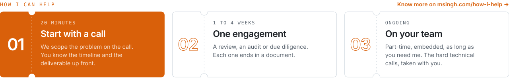
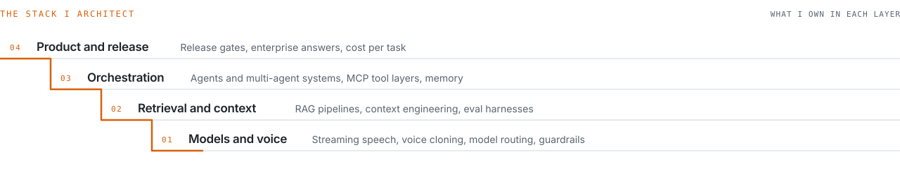

<picture><source media="(prefers-color-scheme: dark)" srcset="assets/strip-dark.svg"></picture>

### Hi, I'm Mandeep

Enterprise AI fails in production for three reasons: untrusted outputs, runaway token costs and integrations that break at scale. I design the systems that solve all three, and I stay until they run on their own. Where AI stops being a feature and becomes a system: that is where I work.

<picture><source media="(prefers-color-scheme: dark)" srcset="assets/status-dark.svg"></picture>

I move companies off brittle LLM wrappers and onto production-grade AI systems: agentic workflows and multi-agent orchestration, advanced RAG with context engineering, low-latency voice, and under them the eval harnesses, programmatic guardrails, LLMOps and token economics that keep them standing once real users arrive. The part I care about is the part after the first result: the agent that still has to answer well with a tool down, in a language the evals never covered, under a budget. Right now that work is at [TWINii](https://twinii.ai), where we build real-time AI twins of real experts, and with a small number of seed to Series B teams I join part-time, embedded.

<a href="https://msingh.com/how-i-help?utm_source=github&utm_medium=profile&utm_campaign=github-readme&utm_content=offers-card"><picture><source media="(prefers-color-scheme: dark)" srcset="assets/offers-tickets-dark.svg"></picture></a>

  <a href="https://msingh.com/connect-with-me?utm_source=github&utm_medium=profile&utm_campaign=github-readme&utm_content=call-button"><picture><source media="(prefers-color-scheme: dark)" srcset="assets/button-call-dark.svg"></picture></a>&nbsp;&nbsp;
  <a href="https://msingh.com/how-i-help?utm_source=github&utm_medium=profile&utm_campaign=github-readme&utm_content=help-button"><picture><source media="(prefers-color-scheme: dark)" srcset="assets/button-help-dark.svg"></picture></a>

**Lately, I've been working on**

- Real-time voice agents: latency budgets, interruption handling, memory that survives a session, guardrails that survive a user.
- Multi-agent orchestration and MCP tool layers that hold their shape as the number of tools grows.
- Eval harnesses and release gates, so a model or prompt change ships with evidence rather than hope.
- Spec-driven development with AI-assisted engineering standards, so coding agents write inside boundaries the team agreed on first.
- Security and supply-chain hardening across an organisation. That programme is why [PolinRider Scanner](https://polinriderscanner.com) exists.
- Inference cost. I read the token bill the way I used to read the AWS bill.

<picture><source media="(prefers-color-scheme: dark)" srcset="assets/stack-dark.svg"></picture>

<picture><source media="(prefers-color-scheme: dark)" srcset="assets/terms-dark.svg"></picture>

**Some of what I've built**

- **TWINii:** the real-time voice pipeline behind AI twins of experts, who answer in their own voice.
- **Devnagri AI:** the voice and language AI platform across 22 Indian languages, as Solutions Architect and then Fractional CTO: multilingual AI workflows, LLMOps and a hybrid cloud that kept spend down while load went up.
- **Shiprocket:** the core of its omnichannel commerce integrations. The company is now a unicorn.
- **HumanFirewall:** first product live in 45 days, as Acting CTO.
- **Balluun:** five years as Solutions Architect for a Silicon Valley B2B market network, through its cloud-native migration.

  <a href="https://msingh.com/?utm_source=github&utm_medium=profile&utm_campaign=github-readme&utm_content=website-button"><picture><source media="(prefers-color-scheme: dark)" srcset="assets/social-site-dark.svg"></picture></a>&nbsp;
  <a href="https://www.linkedin.com/in/mesingh9/"><picture><source media="(prefers-color-scheme: dark)" srcset="assets/social-linkedin-dark.svg"></picture></a>&nbsp;
  <a href="https://x.com/meSingh9"><picture><source media="(prefers-color-scheme: dark)" srcset="assets/social-x-dark.svg"></picture></a>

Tools I use daily 

Mandeep Singh &nbsp;·&nbsp; Delhi, India &nbsp;·&nbsp; <a href="https://msingh.com/?utm_source=github&utm_medium=profile&utm_campaign=github-readme&utm_content=footer">msingh.com</a> &nbsp;·&nbsp; the strips update daily from <a href="https://github.com/meSingh/meSingh/tree/master/scripts">scripts/</a>

